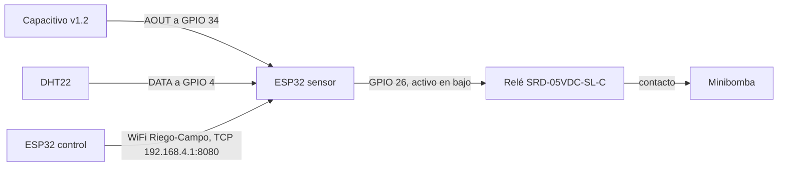

# Diagrama de conexión

Dos ESP32 DevKit V1. El nodo sensor crea la red y lee el campo. El nodo de control no lleva sensores: entra a esa red y abre TCP.

## Alimentación y pines del nodo sensor

| Pieza | VCC | GND | Señal | Notas |
| --- | --- | --- | --- | --- |
| Sensor capacitivo de suelo v1.2 | 3,3 V | GND | AOUT en GPIO 34 | GPIO 34 es ADC1, solo entrada. No alimentarlo a 5 V: la salida analógica iría por encima del pin. |
| DHT22 | 3,3 V | GND | DATA en GPIO 4 | Si el módulo no trae pull-up, una resistencia de 10 kΩ va de DATA a 3,3 V. |
| Relé SRD-05VDC-SL-C | 5 V de la placa | GND | IN en GPIO 26 | El firmware lo trata activo en bajo (`RELE_ACTIVO_BAJO`). |
| Minibomba | Fuente propia | Fuente propia | Los dos contactos del relé | No sale del pin de 3,3 V ni del de 5 V. |

El nodo de control solo se alimenta por USB. Se une a `Riego-Campo` y abre el cliente TCP hacia `192.168.4.1:8080`.

## Orden al subir el programa

1. Grabar `nodo_sensor/nodo_sensor.ino` en el primer ESP32 y dejarlo alimentado. El monitor a 115200 muestra el AP, la línea `ADC suelo` y una trama `$D` cada 2 segundos. El ADC en aire se copia a `SUELO_SECO_ADC` y el ADC en agua a `SUELO_AGUA_ADC`.
2. Grabar `nodo_control/nodo_control.ino` en el segundo ESP32, en otro puerto COM. El monitor a 115200 muestra el panel y acepta `h 40`, `t 24`, `on`, `off` y `auto`.
